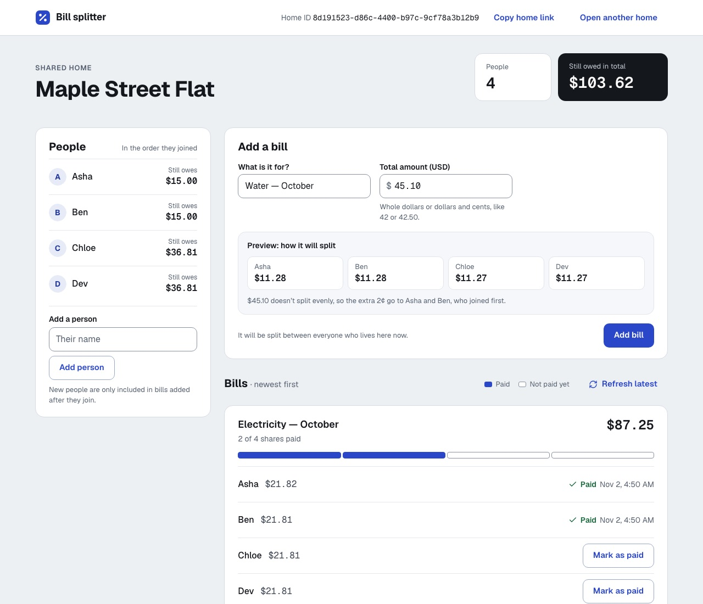

# SDE Intern Assignment: Shared Bill Splitter

Welcome. In this assignment you build a small bill splitter for a shared home. It has two parts:

1. **Homes and members:** create a home and add members to it.
2. **Bill splitting:** split a bill between the members. Each member pays their own share.

The assignment is small on purpose. We want correct, safe, and clear code. We do not want many features.

## What we look at

- **Your code passes the tests.** The tests decide, not opinion. You get the visible tests. We also run extra tests that you do not see.
- **Your code is safe when things go wrong.** Wrong input, repeated requests, and two requests at the same time must not break your data.
- **Your code is typed.** Use TypeScript. Do not use `any`.
- **You understand your code.** You record a short video and explain it.

Take your time. A careful, correct solution is better than a fast one. We expect 2 to 3 days of real work.

## Stack (required)

- **API:** Hono on Cloudflare Workers
- **Database:** Cloudflare D1 (SQLite). The binding is `DB` in `api/wrangler.jsonc`.
- **Web:** React, Vite, TanStack Router
- **Language:** TypeScript on both sides
- **Tests:** Vitest, running inside the Workers runtime
- **Quality:** Biome. `pnpm check` and `pnpm typecheck` must pass.

You choose the rest (styling, form library, validation library). Pick tools you can explain.

## The task

The assignment has two parts. Do Part 1 first. Part 2 builds on it.

**Database.** Write the schema as SQL migration files in `api/migrations/`. For example `0001_init.sql`. The tests apply every file in this folder. Your schema must have **at least 3 named constraints** that protect the data. For example a foreign key, a `CHECK`, or a `UNIQUE` key. Be ready to explain what each constraint stops.

**Errors.** Every error response is JSON: `{ "error": "message" }`.

## Part 1: Homes and members

Create a home and add members to it. The order in which members are added matters in Part 2.

#### `POST /api/homes`

- Request: `{ "name": string }`
- Success: `201` `{ id, name }`

#### `POST /api/homes/:homeId/members`

- Request: `{ "name": string }`
- Success: `201` `{ id, homeId, name }`
- Errors: `404` home not found

Visible tests: `api/test/homes.test.ts`.

## Part 2: Bill splitting

Add a bill to a home, split it between the members, and let each member pay their share.

All amounts are whole **cents** (integers). `100` cents is 1 dollar. Never use decimals for money.

#### `POST /api/homes/:homeId/bills`

- Request: `{ "title": string, "totalCents": number }`
- Success: `201` `{ id, homeId, title, totalCents, shares: [{ id, memberId, amountCents, paidAt: null }] }`
- Errors: `404` home not found. `422` total is not a positive whole number, or the home has no members.

#### `POST /api/bills/:billId/shares/:shareId/pay`

- Request: header `Idempotency-Key`
- Success: `200` `{ id, memberId, amountCents, paidAt }`
- Errors: `400` key missing. `404` bill or share not found. `409` share already paid with a different key.

#### `GET /api/homes/:homeId/balances`

- Success: `200` `{ balances: [{ memberId, name, outstandingCents }] }`
- Errors: `404` home not found

**Rules**

- **Split.** A bill is split between all members of the home. The shares always add up to `totalCents`. If the amount does not divide evenly, the extra cents go to the members one by one, in the order the members were added to the home. Example: 1000 cents between 3 members gives `334`, `333`, `333`.
- **Pay.** Paying marks one share as paid and sets `paidAt`. If the same `Idempotency-Key` is sent again for the same share, answer `200` with the same result. Do not pay twice. If two requests pay the same share at the same time, only one may succeed.
- **Balances.** `outstandingCents` is the sum of the member's unpaid shares, across all bills of the home. List the members in the order they were added.

Visible tests: `api/test/bills.test.ts` and `api/test/payments.test.ts`.

#### Web page

Build one page that:

- shows the bills of a home and the shares of each bill,
- lets a member pay a share,
- shows clear **loading**, **empty**, and **error** states,
- keeps the share unpaid and shows an error if the payment fails.

The page must not crash when the API answers with an error or is slow.

## Cases you must handle

You must handle these cases and talk about them in your video:

1. A home with no members.
2. An amount that is zero, negative, or not a whole number.
3. An amount that does not divide evenly.
4. The same payment request sent twice.
5. Two members paying the same share at the same time.
6. A bill or share that does not exist.
7. The API answers with a 500 error or is slow. The web page must not crash.

## Run it

This is a pnpm workspace. Install once at the root.

```bash
pnpm install
pnpm dev          # api on :8787 and web on :5173
```

Open http://localhost:5173 to create a home or open one by its link or ID. `/api/health` returns `{ "status": "ok" }`.

```bash
pnpm test         # API tests (api/test) and web unit tests (web/src)
pnpm check        # Biome: format and lint. Must pass.
pnpm check:fix    # fix what Biome can fix
pnpm typecheck    # tsc on both packages. Must pass.
pnpm build        # production build of the web app
```

`pnpm dev` applies your migrations to a local database before it starts the API.

Browser tests (Playwright, in `web/e2e`) cover creating a home and a bill, a failed
payment retried with the same key, a lost reply, slow and failing loads, reloading,
two tabs paying the same share, and refreshing. They need a browser once, and they
start the API and web servers themselves if they aren't already running:

```bash
pnpm --filter bill-splitter-web exec playwright install chromium   # once
pnpm test:e2e
```

If pnpm says some build scripts were ignored, run `pnpm approve-builds` and allow `esbuild` and `workerd`.

When you change `api/wrangler.jsonc`, refresh the `Env` types:

```bash
pnpm --filter bill-splitter-api cf-typegen
```

## Rules for the tests

- The visible tests are in `api/test`. They start with a failing result. Your job is to make them pass.
- Do **not** change the visible tests or `api/test/helpers.ts`. We compare them with the original.
- We run extra tests after you submit. They test the cases in "Cases you must handle" more closely.

## AI policy

You can use AI tools. Tell us which ones and where in your answers on the form.
You must understand every line you submit. We check this with your video and in a live call. "The AI wrote it" is not an answer.

## How to submit

1. Click **Use this template**, then **Create a new repository**. Make the repository **public**.
2. Build your solution in your new repository. Small, clear commits are welcome.
3. Update this README with a short section called **Decisions**. Write 3 decisions you made and why.
4. Record a video of **3 minutes or less** (Loom or unlisted YouTube). Show the architecture, the data flow, and one trade-off you made. Make sure anyone with the link can view it.
5. Paste the repository link and the video link in the application form.

We will run `pnpm install && pnpm check && pnpm typecheck && pnpm test` on your repository.

## Decisions

1. **Preserve member order with an integer sequence.** Members get an internal,
   auto-incremented `seq`. Unlike timestamps, it cannot tie, so leftover cents and
   balances follow join order. SQL constraints reject invalid amounts, duplicate
   shares, missing references, and inconsistent payment records.
2. **Save a bill and its shares in one D1 batch.** If any insert fails, the entire
   bill rolls back. The member list read before the batch is its snapshot: members
   added later do not change existing bills. `GET /api/homes/:homeId` and
   `GET /api/homes/:homeId/bills` are extra read endpoints for the web page; bills
   are newest first, with shares in join order, fetched without a query per bill.
3. **Mark payments with a conditional update.** `UPDATE ... WHERE paid_at IS NULL`
   lets only one request mark a share paid. The key is stored on that share, so
   retries return its original timestamp and a different key returns `409`.
   Keys are scoped per share. This avoids a separate idempotency table for an
   operation that can happen only once. This endpoint records payment status;
   it does not transfer money.

## Screenshot



## Notes

**Who can do what.** The brief has no accounts, so access is link-based: anyone
who has a home's ID can view it, add people, add bills and mark shares as paid.
Nothing is checked beyond that. A next version would add sign-in and enforce
these rules on the server, refusing everything else with a clear `403`:

- only people in a home can view it or add bills to it;
- a person can mark only their own share as paid;
- only the person who created the home can add people to it.

**Input limits.** Names and bill titles are trimmed and must be 1 to 100
characters. `totalCents` can be any positive whole number up to
`Number.MAX_SAFE_INTEGER` (9,007,199,254,740,991). A home's bills may add up to
at most that same amount, so every balance stays an exact whole number; a bill
that would go over is refused with `422`. A database trigger enforces this, so it
also holds when two bills are created at the same moment. The `Idempotency-Key`
must not be blank and is at most 200 characters; it is stored exactly as sent.

**How the web page handles failures.** "Mark as paid" records that a share is
settled; no money moves. A share shows as paid only after the server confirms it.
If the server answers with an error the page can trust (a `4xx`), the share stays
unpaid and the page says why. If the reply is lost (timeout, dropped connection,
`5xx`, or an unreadable body), the outcome is unknown, so the page reloads the
bills to check before offering a retry, and a retry sends the same
`Idempotency-Key`, so the share can never be marked twice. Adding a bill or a
person follows the same rule: an unknown outcome reloads the list instead of
claiming nothing was saved. A slow or older reload can't overwrite newer data.
If a background reload fails, the page keeps what it already shows and says
"Couldn't refresh" with a retry button. Other people's changes appear when the
page reloads; "Refresh latest" does that on demand, instead of live updates.
Displayed balances are calculated from the displayed bill shares, so separate
API reads during a concurrent change cannot make the totals disagree. Member
names are read after bills to include anyone who joined before those bills.
